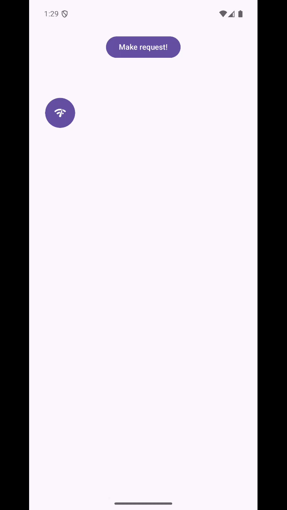
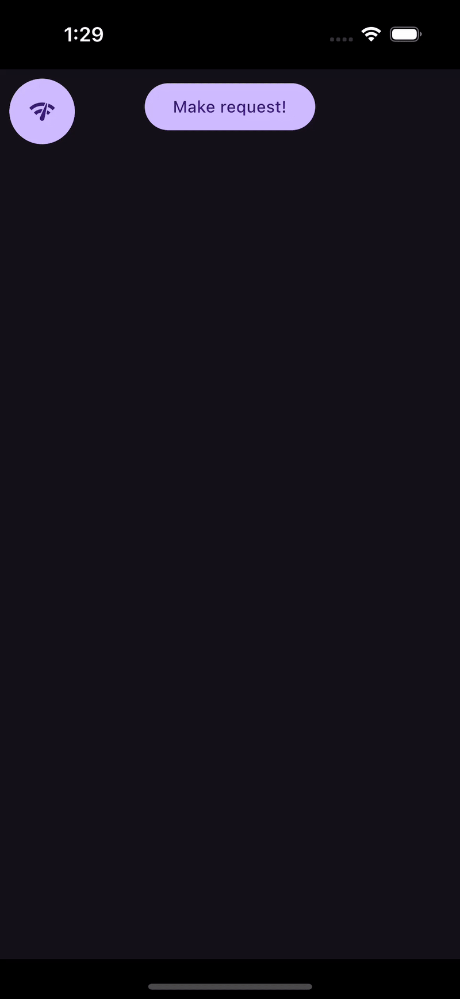

# LensLogger


LensLogger is a Kotlin Multiplatform (KMP) library for Android, iOS and Desktop that makes debugging network requests effortless.
It automatically logs all Ktor network requests and responses, and provides a built-in UI to inspect these logs directly in your app. 
This helps you quickly identify issues and monitor network activity during development.

## Features
- ✨ Seamless integration with Ktor HTTP client
- 🔌 OkHttp application interceptor for Retrofit / raw `OkHttpClient` (Android and JVM desktop)
- 📱 Works on both Android and iOS (KMP)
- 🔍 Logs all network requests and responses
- 🖥️ Built-in UI for real-time log inspection and mocking
- 🛠️ Minimal setup and easy to use
- ✨ DataStore Visualizer
- ✨ Mock response

## Documentation

- [Setup & API](https://farhazulmullick.github.io/Lens-Logger/): installation, Ktor / OkHttp setup, Lens UI integration, and Android setup.
- [Network Visualizer](https://farhazulmullick.github.io/Lens-Logger/network.html): inspect captured requests and responses.
- [Network Mocking](https://farhazulmullick.github.io/Lens-Logger/mocking.html): configure and replay mock responses.
- [DataStore Visualizer](https://farhazulmullick.github.io/Lens-Logger/datastore.html): inspect Preferences DataStore.
- [Mock result examples](https://farhazulmullick.github.io/Lens-Logger/examples.html): screenshot walkthrough of successful and failed mock results.

## Demo

| Android                                                                       | iOS                                                                       | Desktop (Windows)                                                            |
|-------------------------------------------------------------------------------|---------------------------------------------------------------------------|------------------------------------------------------------------------------|
|  |  |
| 


## Installation

Add the LensLogger artifact to your module's commonMain dependencies:

```kotlin
dependencies {
    implementation("io.github.farhazulmullick:lens-logger:<version>")
}
```
Or add to your `libs.versions.toml`:
```toml
lensLoggerVersion = "<version>"
lens-logger = { module = "io.github.farhazulmullick:lens-logger", version.ref = "lensLoggerVersion" }
```

## Usage

### 1. Integrate with Ktor Client

In your shared code (e.g., `commonMain`):

```kotlin
import io.github.farhazulmullick.lenslogger.*
import io.ktor.client.*
import io.ktor.client.engine.*
import io.ktor.client.plugins.logging.*

val client = HttpClient(engine) {
    // Replace install(Logging) with this.
    // Log request/response in Logcat and LensUi as well.
    LensHttpLogger {
        level = LogLevel.ALL
        logger = object : Logger {
            override fun log(message: String) {
                Napier.d(message = message)
            }
        }
    }.also { 
        // setup up nappier logger.
        Napier.base(DebugAntilog()) 
    }
}

/******************* OR ********************/
/** Install only LensLogger **/

val client = HttpClient(engine) {
    // body 
    install(LensHttpLogger){
        level = LogLevel.ALL
    }
}

```

### 2. OkHttp / Retrofit (Android and JVM desktop)

Install **`LensOkHttpInterceptor`** on the **application** interceptor chain of the `OkHttpClient` you use with Retrofit (or any OkHttp-based API). The library exposes a small helper:

```kotlin
import io.github.farhazulmullick.lenslogger.plugin.network.installLensInterceptor
import okhttp3.OkHttpClient

val okHttpClient = OkHttpClient.Builder()
    .installLensInterceptor()
    // other interceptors, timeouts, etc.
    .build()
```

Equivalent without the extension:

```kotlin
import io.github.farhazulmullick.lenslogger.plugin.network.LensOkHttpInterceptor

OkHttpClient.Builder()
    .addInterceptor(LensOkHttpInterceptor())
    .build()
```

Calls made through this client appear in the same network log store as Ktor traffic, so they show up in the Lens inspector and respect the same mocking rules where applicable. The interceptor uses blocking work internally; keep it on clients that run network I/O off the main thread (typical for Retrofit).

### 3. Lens UI — Compose root (`LensApp`)

When your root UI is Compose, wrap your app with `LensApp`. That adds a draggable FAB that opens the bottom sheet inspector (`LensContent`). Pass `dataStores` if you use the DataStore tab.

```kotlin
import io.github.farhazulmullick.lenslogger.ui.LensApp
import androidx.compose.ui.Modifier

LensApp(
    modifier = Modifier.fillMaxSize(),
    showLensFAB = true,
    sheetGesturesEnabled = false,
    dataStores = myDataStores,
) {
    App()
}
```

There is **no** separate window-level `ComposeView` overlay on activities: the FAB lives in your Compose tree only.

> **Note:** Wire at least one of **Ktor** (step 1) or **OkHttp** (step 2) so the Network tab has traffic to show.

### 4. Android without a Compose root (`LensAndroid`)

If you do **not** have a single Compose root (classic `Activity` / XML / fragments), skip `LensApp` and call **`LensAndroid.install`** once from **`Application.onCreate`** on the main thread. That posts a **persistent notification** that opens **`LensActivity`** (full-screen inspector). Configuration only needs a **`dataStoresProvider`** (return an empty list if you do not use DataStore in Lens).

```kotlin
import android.app.Application
import io.github.farhazulmullick.lenslogger.ui.LensAndroid
import io.github.farhazulmullick.lenslogger.ui.LensInstallConfiguration

class MyApp : Application() {
    override fun onCreate() {
        super.onCreate()
        LensAndroid.install(
            this,
            LensInstallConfiguration(dataStoresProvider = { ctx -> emptyList() }),
        )
    }
}
```

Register the application class in the manifest (`android:name=".MyApp"`). Call **`LensAndroid.uninstall(this)`** with the same `Application` to cancel the notification and clear cached DataStores. After the user grants **`POST_NOTIFICATIONS`** (API 33+), call **`LensAndroid.refreshPersistentNotification(application)`** if the notification was not shown at install time.

**iOS:** use your own navigation to embed or present the shared inspector UI as needed; the notification-based entry point is Android-only.

## License

This project is licensed under the MIT License - see the [LICENSE](./LICENSE) file for details.
